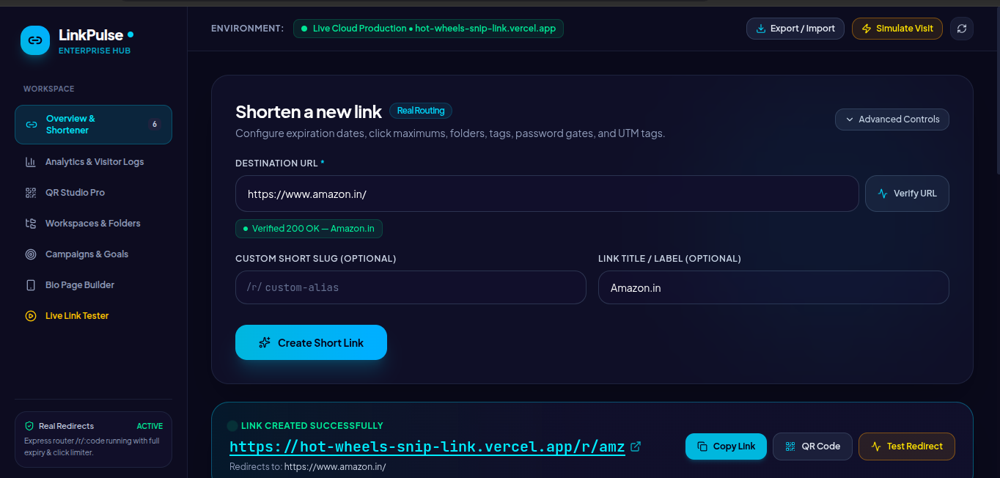
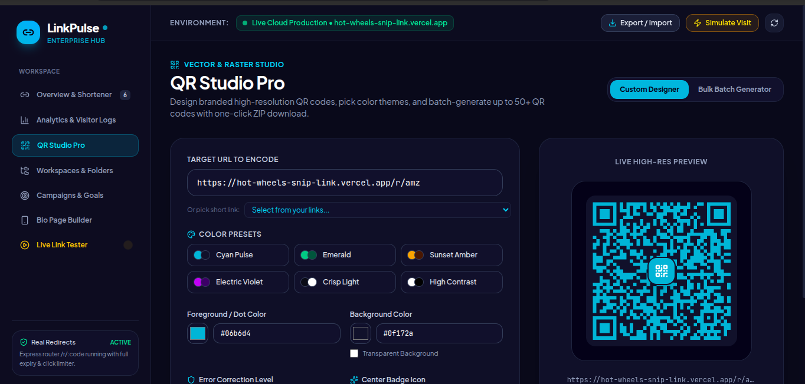
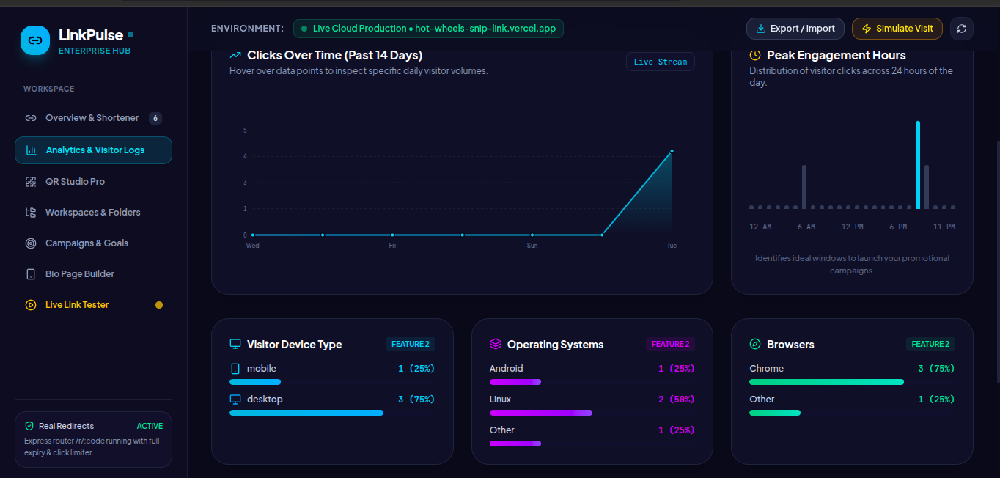
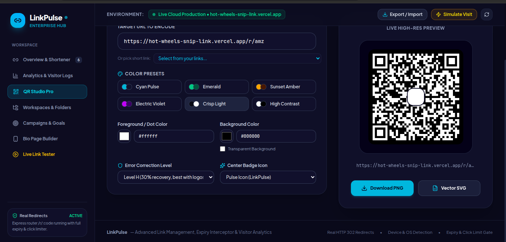

<div align="center">

# 🔗 LinkPulse

**Shorten links · Create QR codes · Track clicks**

[🌐 **Live Demo**](https://hot-wheels-snip-link.vercel.app)

</div>

## 💡 Problem & Solution
Long URLs are hard to share and track. LinkPulse combines short links, real redirects, QR customization, and visitor analytics in one dashboard.

## ✨ Features
- Create short links with custom slugs and labels.
- Verify destination URLs and test redirects.
- Customize QR codes and export PNG/SVG.
- View clicks, peak hours, devices, operating systems, and browsers.
- Organize links with folders, campaigns, and tags.
- Includes advanced options for expiry, click limits, password gates, A/B testing, and UTM parameters.

## 🖼️ Screenshots

| Shortener | QR Studio |
|---|---|
|  |  |

| Analytics | QR Customization |
|---|---|
|  |  |

## 🧰 Tech Stack
React/TypeScript, Node.js/TypeScript, Neon PostgreSQL, Vercel, Git, and GitHub. Confirm exact dependencies in `package.json`.

## ⚙️ Setup
```bash
git clone https://github.com/Gaurav-Pathak-code/Hot-Wheels_Snip-link.git
cd Hot-Wheels_Snip-link
npm install
```
Set `DATABASE_URL` in a local `.env` file, then run the scripts in `package.json`. Never commit secrets; keep `.env` in `.gitignore`.

