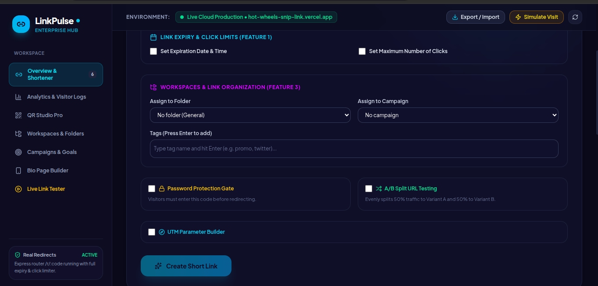

# 🔗 LinkPulse

**Shorten links · Create QR codes · Track clicks**

[🌐 Live Demo](https://hot-wheels-snip-link.vercel.app/)

## 💡 Problem & Solution

Long URLs are difficult to share and track. LinkPulse combines link shortening, QR customization, and click analytics in one dashboard.

## ✨ Features

- Create short links with custom slugs and labels.
- Verify destination URLs and test redirects.
- Customize QR codes and export PNG/SVG.
- View click trends, devices, operating systems, and browsers.
- Organize links with folders, campaigns, and tags.
- Configure expiry dates, click limits, password gates, A/B testing, and UTM parameters.

## 🖼️ Screenshots

| Shortener | Analytics |
|---|---|
|  |  |

| QR Studio | QR Customization |
|---|---|
|  |  |

### Advanced Controls



## 🧰 Tech Stack

React, TypeScript, Node.js, Neon PostgreSQL, Vercel, Git, and GitHub.

## ⚙️ Setup

```bash
git clone https://github.com/Gaurav-Pathak-code/Hot-Wheels_Snip-link.git
cd Hot-Wheels_Snip-link
npm install
```

Set `DATABASE_URL` in your local `.env` file and use the scripts in `package.json`. Never commit secrets; keep `.env` in `.gitignore`.

## 👥 Team

Keep the repository public and follow the required `teamname-projectname` naming rule. Use meaningful commit messages and have every team member commit from their own GitHub account.